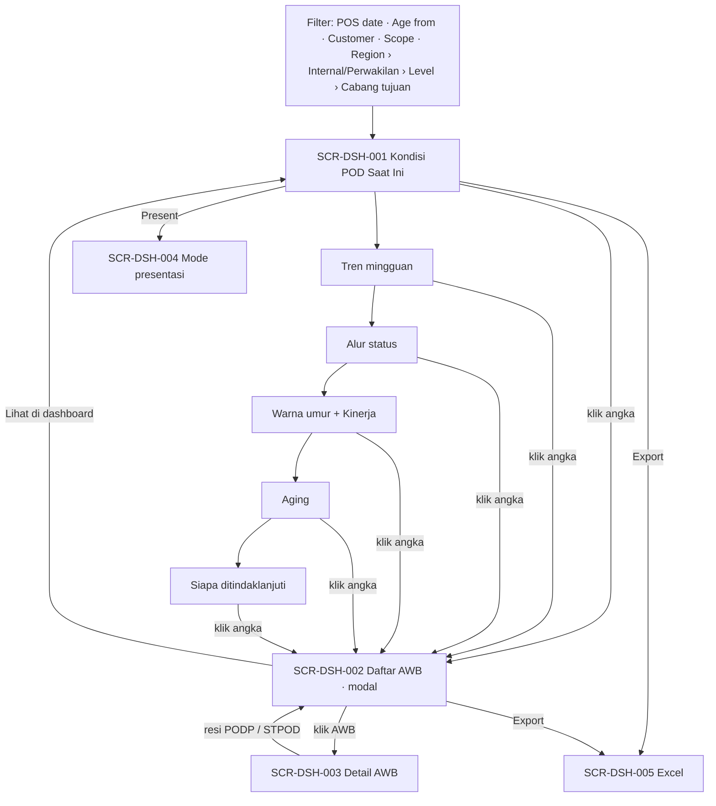

# UX Foundations — PCP DashOps

> Mode tereduksi: SRS, use case, dan dokumen arsitektur belum ada, jadi tidak ada ID FR/NFR/UC yang dikutip.
> Persona dan alur diturunkan dari kebutuhan user di sesi desain (25 Nov 2026). Nilai visual ada di `docs/design.md` / `docs/tokens.json` — tidak diulang di sini.

## 1. Persona (asumsi, perlu konfirmasi)
| Persona | Tujuan | Pertanyaan < 1 menit |
|---|---|---|
| Manajer operasional pusat | Menekan tunggakan POD & keterlambatan | "Kondisi POD sekarang baik atau tidak? Di mana masalahnya?" |
| Admin cabang tujuan | Menagih POD yang belum kembali | "AWB mana di cabang saya yang sudah merah/ungu?" |
| Finance / billing | Penagihan yang tertahan POD | "Berapa Rp tertahan dan di customer mana?" |
| Presenter (rapat) | Memaparkan kinerja | "Tampilkan per bagian, satu layar penuh" |

## 2. Surface
| Kode | Surface | Perangkat |
|---|---|---|
| DSH | Web dashboard internal | Desktop (utama), tablet, HP (baca & drill-down), proyektor (mode presentasi) |

## 3. Arsitektur informasi

## 4. Alur kunci
1. **Baca kondisi (< 1 menit):** Total → banner status → 5 KPI → Focus now.
2. **Drill-down:** angka mana pun → daftar AWB (saring warna/penyumbang/cari) → detail AWB → dokumen PODP/STPOD.
3. **Balik ke ringkasan:** "Lihat posisinya di dashboard" menerapkan saringan & menandai baris.
4. **Presentasi:** Present → 6 slide → Esc.
5. **Export:** ringkasan & daftar sesuai filter aktif.

## 5. Inventaris layar (ID stabil — jangan dinomori ulang)
| ID | Layar | Tujuan | State wajib |
|---|---|---|---|
| SCR-DSH-001 | Dashboard ringkasan | Kondisi, tren, alur, aging, peringkat | default, filter tanpa data, lib grafik gagal, reduced motion |
| SCR-DSH-002 | Daftar AWB (modal) | Drill-down dari angka mana pun | default, hasil cari kosong, saringan dokumen (PODP/STPOD), paging |
| SCR-DSH-003 | Detail AWB (modal) | Perjalanan dokumen & tautan terkait | delivered/belum, sudah balik/belum, tidak balik |
| SCR-DSH-004 | Mode presentasi | Paparan rapat | fullscreen ditolak (tetap jalan tanpa fullscreen), modal di atas slide |
| SCR-DSH-005 | Export Excel | Ringkasan + daftar | sukses, dibatalkan, lib gagal, tidak tersedia di tampilan |
| SCR-DSH-006 | Date range picker | Pilih rentang POS | pilih awal, pilih akhir, tanggal masa depan nonaktif |

## 6. Konsistensi lintas layar
- Setiap angka AWB = jumlah + Rp; setiap angka bisa diklik dan sama dengan jumlah baris di daftar (dijaga e2e).
- Satu warna = satu fungsi (lihat design.md §1).
- Semua istilah punya penjelasan singkat terlihat + hint lengkap.
